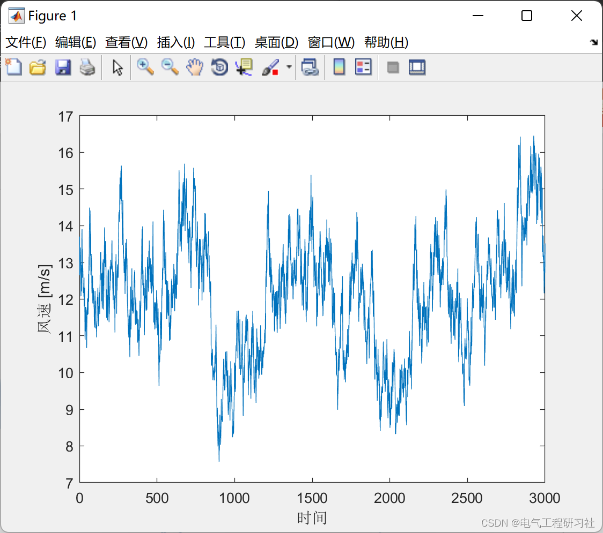
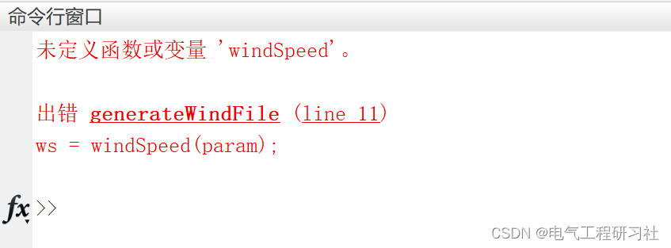

# Uncertainty of Distributed Energy - Wind Speed Test (Matlab Code Implementation)

​  
📋📋📋This article is organized as follows: ⛳️⛳️⛳️Table of Contents1. Overview2. Simple Speed Test with Matlab3. Final Thoughts1. Overview1.1 Hot-Wire Velocimeter
- This method is to test the resistance change caused by the sensor cooling due to wind when it is in a power state, thereby testing the wind speed. It cannot obtain information about the direction of the wind.
・In addition to being easy to carry, it has a high cost-performance ratio and is widely used as the standard product for wind speed meters.
- The basic components of a hot-wire anemometer include platinum wires. Thermocouple Semiconductor-related. However, our company uses platinum-coated wire. The material of the platinum wire is most stable in substance. Therefore, Long-term stability And has advantages in temperature compensation.
1.2 Rotor-type wind speed meter
- This method applies the principle of a windmill, testing the number of rotations of the impeller to measure the wind speed.
- Used for meteorological observation and other purposes.
・Low popularity.
2. Simple speed measurement in Matlab code
%% Test wind speed\nclc; \nclear; \nclose all;\nrng(1);\n\n%% Parameters\nparam.Ts = 60*10;\nparam.z = 35;\nvMean = 12;\nws = windSpeed(param);\n\n%% Simulation\nN = 3000;\nw = zeros(1,N);\nws.setNumVdhSpec(20);\n\nfor i=1:N\n    w(i) = ws.sample(i,vMean);\nend\n\n%% Visualization\nfigure\nplot(w)\nylabel('Wind speed [m/s]')\nxlabel('Time')\n\n%% Save to file\nfilename = sprintf('wind_%.2f.mat',vMean);\nt=0:ws.Ts:(N-1)*ws.Ts;\noutput=[t; w];\nsave(filename,'output','-v7.3');\n  
If the operation is as follows:
Edit
Make sure to download and place "windSpeed" in the same folder as the code above.
3 Reference theoretical literature online, if any infringement, please contact the blogger for removal.

## Images

<!-- PAYMENT_BLOCK -->

## Get this dataset

- Payment link (Stripe): [Buy now](https://buy.stripe.com/3cs8yP7sY87d0vu9AB)
- Payment QR code: 

<!-- /PAYMENT_BLOCK -->
